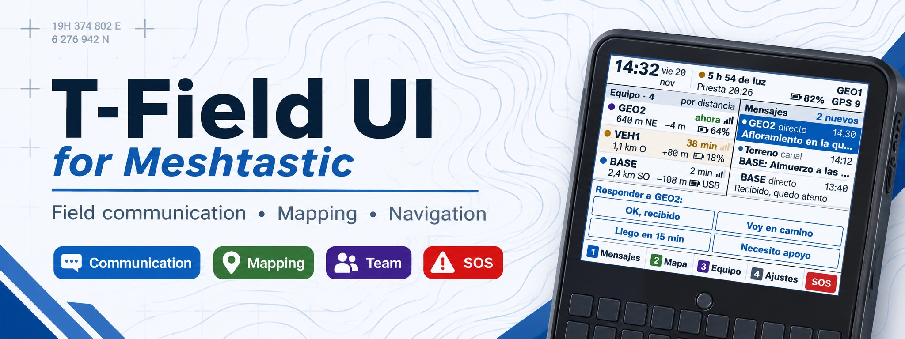
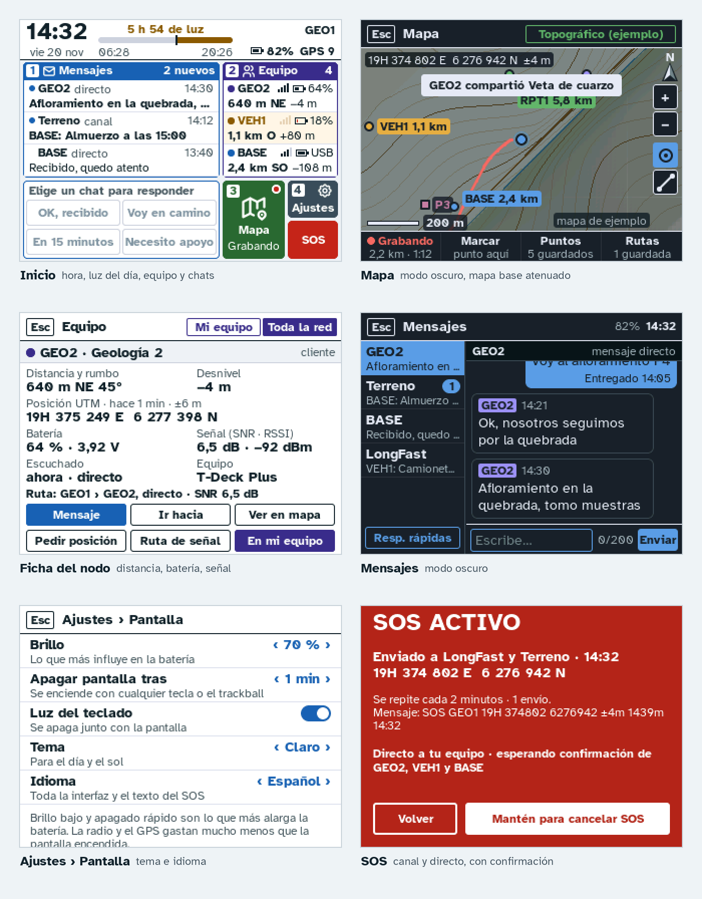

<p align="center">
  
</p>

# T-Field UI

[English](README.md) · **Español**

[](https://github.com/Roberto-Larregla/t-field-ui/actions/workflows/pruebas.yml)
[](https://github.com/Roberto-Larregla/t-field-ui/actions/workflows/firmware.yml)

Interfaz de terreno para la **LILYGO T-Deck Plus** con **Meshtastic**: mensajes, mapa con coordenadas UTM, rutas GPX, seguimiento del equipo y SOS. Reemplaza la interfaz de pantalla estándar de Meshtastic y funciona con cualquier otro nodo Meshtastic, la app del teléfono y los repetidores.

La interfaz está en **español e inglés**, con tema **claro, oscuro o automático** (oscuro entre la puesta y la salida del sol).

> **Estado:** primera versión en el equipo. La interfaz está completa y pasa las pruebas automáticas; la integración con el firmware es nueva. Si algo no funciona, avisa en [Issues](https://github.com/Roberto-Larregla/t-field-ui/issues).



## Qué hace

- **Inicio:** hora, luz del día que queda, batería y GPS propios; distancia, rumbo, diferencia de altura, batería y señal de cada compañero; últimos chats y respuestas rápidas.
- **Mensajes:** chats y canales, respuestas rápidas editables, contador de bytes (el límite de Meshtastic) y puntos compartidos que se abren en el mapa. Borrar un chat (dos pulsaciones), todos, o los mensajes de más de 1, 7 o 30 días.
- **Mapa:** mapa base desde la tarjeta SD o cuadrícula UTM; puntos (P1, P2…), rutas grabadas en GPX (R1, R2…), regla, destino y rastro de cada compañero.
- **Equipo:** «Mi equipo» y toda la red; ficha de cada nodo, pedir posiciones a todos y ruta de señal.
- **SOS:** por el canal y directo a cada miembro, mostrando quién lo recibió.
- **Ajustes:** pantalla (brillo, tema e idioma), GPS, mensajes, mapa, canal privado con invitación cifrada, SOS, nodo y hora, y radio.
- **Modo oscuro:** no encandila de noche y atenúa el mapa base. En la pantalla IPS de la T-Deck no ahorra batería: eso lo hace el brillo.
- **Teclado y bola:** todo se puede usar sin tocar la pantalla.

## Instalación

T-Field UI se instala compilando el firmware de Meshtastic con una versión de [`device-ui`](https://github.com/meshtastic/device-ui) (la librería que dibuja la pantalla de Meshtastic) que muestra T-Field UI. En el firmware cambia una sola línea.

### Qué se necesita

- Una LILYGO **T-Deck Plus**. La T-Deck sin «Plus» también sirve, pero no tiene GPS.
- Un cable USB-C **de datos** (algunos cables solo cargan).
- Un computador con Windows, macOS o Linux, [VS Code](https://code.visualstudio.com) y la extensión [PlatformIO](https://platformio.org/install/ide?install=vscode). Si prefieres la terminal, basta con [PlatformIO Core](https://docs.platformio.org/en/latest/core/installation/index.html).
- [Git](https://git-scm.com/downloads).
- Opcional: una tarjeta microSD para mapas base, rutas y puntos.

Si la T-Deck nunca ha tenido Meshtastic, instala primero el firmware estándar con el [Web Flasher de Meshtastic](https://flasher.meshtastic.org) («Full Erase and Install»). Así queda preparada la memoria del equipo.

### 1. Descargar el firmware de Meshtastic

En una terminal:

```sh
git clone https://github.com/meshtastic/firmware.git
cd firmware
git checkout fe89ac1ddbbe02cdcc4d15a33f1967f5dcd55daa
git submodule update --init
```

T-Field UI se compila con ese commit.

### 2. Apuntar el firmware a la versión de device-ui con T-Field UI

Abre `platformio.ini` (en la carpeta `firmware`) y busca la sección `[device-ui_base]`. Reemplaza la línea que empieza con `https://github.com/meshtastic/device-ui/archive/` por:

```ini
	https://github.com/Roberto-Larregla/device-ui/archive/5c45b7a73a9362013b969b48acc684a914277961.zip
```

Deja la tabulación al comienzo de la línea. Nada más cambia en el firmware: la radio, la malla, el GPS y el cifrado siguen siendo los de Meshtastic.

### 3. Compilar e instalar

1. Abre la carpeta `firmware` en VS Code. La primera vez, PlatformIO descarga lo que necesita; puede tardar.
2. Elige el entorno **`env:t-deck-tft`** (barra de PlatformIO, abajo en la ventana).
3. Pon la T-Deck en modo de descarga: apágala, mantén presionada la **bola**, enciéndela y suelta la bola después de 2 o 3 segundos. La pantalla queda negra.
4. Conecta la T-Deck al computador con el cable USB-C y pulsa **Upload** (la flecha → en la barra de PlatformIO).
5. Al terminar, apaga y vuelve a encender la T-Deck.

Desde la terminal, los pasos 2 y 4 son: `pio run -e t-deck-tft -t upload`

El firmware conserva los ajustes de Meshtastic del equipo (región, canales, nombre). Para volver a la interfaz estándar, instala de nuevo el firmware oficial con el Web Flasher.

Si la compilación se detiene con `IncompatiblePlatform` y `PlatformIO Core v6.2.0-post.1`, es un problema conocido de la segunda pasada de la plataforma ESP32. Ejecuta esto una vez y vuelve a compilar:

```sh
~/.platformio/penv/bin/python -m ensurepip
~/.platformio/penv/bin/python -m pip install "pioarduino==6.2.0"
```

En Windows la carpeta es `%USERPROFILE%\.platformio\penv\Scripts\`.

### 4. Preparar la tarjeta microSD (opcional)

Formatea la tarjeta en FAT32 o exFAT. T-Field UI lee los mapas base de `/maps` y crea la carpeta `/tfield` para sus archivos:

```
/maps/<nombre>/<z>/<x>/<y>.png     mapa base: teselas PNG de 256 × 256 px
/maps/<nombre>/<nombre>.pmtiles    o un solo archivo PMTiles (teselas PNG)
/tfield/rutas/                     rutas grabadas (GPX)
/tfield/puntos.gpx                 puntos (GPX)
```

Cada carpeta de `/maps` es un mapa base: el botón de arriba del mapa muestra el actual y permite elegir otro. Sin tarjeta, o fuera de las teselas, el mapa muestra una cuadrícula UTM. Los GPX se abren en QGIS, Google Earth y la mayoría de las apps de GPS.

Para hacer teselas con tus propios mapas en [QGIS](https://qgis.org): *Caja de herramientas de Procesos › Herramientas ráster › Generar teselas XYZ (Directorio)*, formato PNG, zoom 10 a 17. Copia la carpeta resultante en `/maps`.

### 5. Primera configuración en el equipo

Ajustes es la cuarta pestaña del inicio (o la tecla `4`).

1. **Ajustes › Pantalla:** idioma, tema y brillo.
2. **Ajustes › Avanzado:** la **región LoRa** de tu país (ver la [lista de Meshtastic](https://meshtastic.org/docs/configuration/region-by-country/)) y el **preset**. Todos los equipos del grupo necesitan la misma región y el mismo preset. Aplicar reinicia la radio.
3. **Ajustes › Nodo y hora:** nombre corto (4 caracteres), nombre largo y zona horaria.
4. **Equipo › Toda la red:** abre la ficha de cada compañero y elige **Agregar a equipo**. Desde ahí aparecen en el inicio con distancia y rumbo.
5. **Ajustes › Canal privado** (opcional): crea el canal e invita a tu equipo. Las invitaciones van cifradas de extremo a extremo, así que solo llegan a nodos cuya clave pública tu equipo ya conoce (nodos que ha escuchado).
6. **Ajustes › SOS:** elige quién recibe tu SOS.

## Limitaciones conocidas

- **Sonido:** T-Field UI no tiene sonidos propios. Si la *Notificación externa* de Meshtastic está activada (se ajusta en la app de Meshtastic), cada mensaje de texto que llega suena con el tono de Meshtastic, lo mande quien lo mande. Los puntos compartidos no suenan.
- **Canal privado y puntos compartidos:** los botones «Unirse» y «Ver en el mapa» funcionan entre equipos con T-Field UI. Las otras apps de Meshtastic reciben los puntos como waypoints estándar.
- **Grabar una ruta** le pide al GPS una posición cada pocos segundos mientras graba, lo que gasta más batería; al detenerla vuelve el intervalo anterior.

## Para desarrolladores

- `include/tfield/`, `src/`: la interfaz (C++17, LVGL 9). No sabe nada de Meshtastic: un adaptador llena sus datos (`set_team`, `add_message`, `set_position`…) y responde a sus ganchos (`on_send_text`, `on_sos`, `on_settings`, `on_save_file`…).
- El adaptador es [`TFieldView`](https://github.com/Roberto-Larregla/device-ui/blob/master/source/graphics/TFT/TFieldView.cpp), en el fork de device-ui. El `library.json` del fork fija el commit de T-Field UI que usa.
- `sim/` y `tests/`: un simulador y pruebas automáticas, con CMake. Corren en cada push ([Pruebas](https://github.com/Roberto-Larregla/t-field-ui/actions/workflows/pruebas.yml)). [Firmware](https://github.com/Roberto-Larregla/t-field-ui/actions/workflows/firmware.yml) compila el firmware de la T-Deck con el código actual y deja los `.bin` para descargar.
- Límites pensados para la T-Deck (ESP32-S3, 8 MB de PSRAM): 60 mensajes por chat y 600 en total, rastro de 200 puntos por compañero, 10 teselas del mapa base en memoria. Solo se redibuja lo que cambia.

<details>
<summary>Regenerar las fuentes</summary>

Desde la carpeta `fonts/` (cada archivo `.c` guarda en su encabezado el comando exacto con que se hizo):

```sh
npm i -g lv_font_conv
lv_font_conv --no-compress --bpp 4 --size 12 --font src/AtkinsonHyperlegible-Regular.ttf \
  -r 0x20-0x7E -r 0xA0-0xFF -r 0x2013,0x2014,0x2022,0x2026,0x2039,0x203A,0x2212 \
  --format lvgl --lv-include lvgl.h --lv-font-name tfield_font_12 -o tfield_font_12.c
```
</details>

## Créditos

- **Autor:** Roberto Larregla.
- Desarrollado con la ayuda de **Claude**.
- [LVGL](https://lvgl.io) (MIT) y [Meshtastic](https://meshtastic.org) (GPL-3.0).
- Fuente [Atkinson Hyperlegible](https://www.brailleinstitute.org/freefont/), del Braille Institute (SIL Open Font License 1.1, ver `fonts/OFL.txt`).

## Licencia

GPL-3.0, la misma de `meshtastic/device-ui`. Ver [LICENSE](LICENSE).
