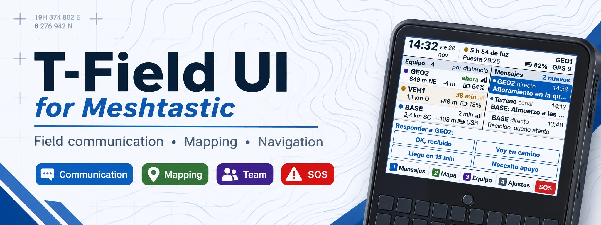
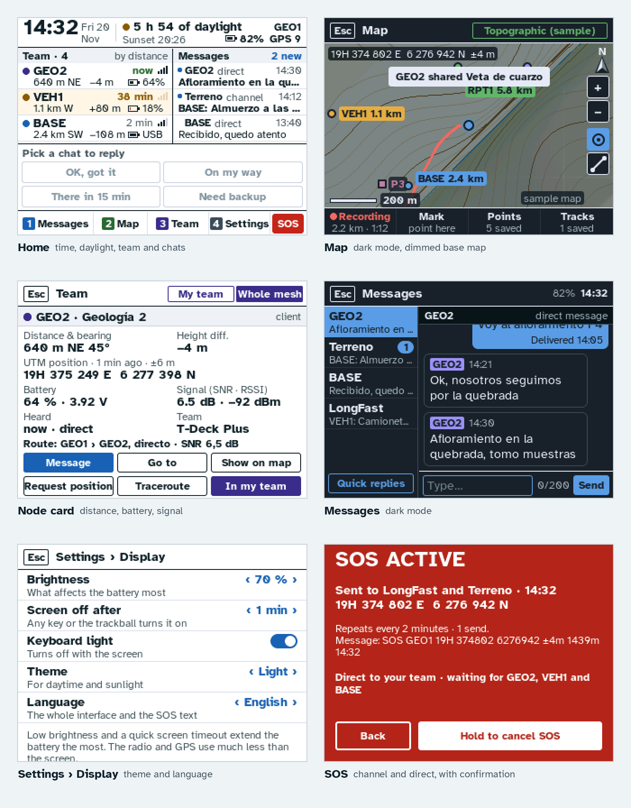

<p align="center">
  
</p>

# T-Field UI

**English** · [Español](README.es.md)

[](https://github.com/Roberto-Larregla/t-field-ui/actions/workflows/pruebas.yml)

A field user interface for the **LILYGO T-Deck Plus** running **Meshtastic**: messaging, a map with UTM coordinates, GPX tracks, team tracking and SOS, with no external sensors. It is written in C++ with LVGL, at the device's real size (320 × 240 px), to be integrated into [`meshtastic/device-ui`](https://github.com/meshtastic/device-ui).

The interface comes in **Spanish and English**, with a **light, dark or automatic** theme (dark from sunset to sunrise). It was designed for geology and environmental fieldwork in Chile.

> **Status:** in development. The full interface runs in the simulator and passes the automated tests. The adapter that connects it to the firmware is the next step: see the [implementation plan](docs/plan-implementacion.md) (in Spanish).



## Features

- **Home:** time, remaining daylight, own battery and GPS; distance, bearing, height difference, battery and signal for each teammate; latest chats and quick replies.
- **Messages:** chats and channels, editable quick replies, a byte counter (Meshtastic's real limit) and shared waypoints with "Ver en el mapa" (show on map).
- **Map:** base map tiles from the SD card or a UTM grid; waypoints (P1, P2…), recorded GPX tracks (R1, R2…), a ruler, a navigation target and each teammate's trail.
- **Team:** "my team" and the whole mesh; a card for each node, request positions from everyone, and traceroute.
- **SOS:** sent on the channel and directly to each teammate, showing who received it.
- **Settings:** display (brightness, theme, language), GPS, alerts, messages, map, a private channel with encrypted invitations, SOS, node and time, and radio.
- **Dark mode:** no glare at night, with the base map dimmed. On the T-Deck's IPS screen it doesn't save battery: the backlight does that.
- **Keyboard and trackball:** everything works without touching the screen. *Backspace* goes back and *Shift+$* adds accents.

## Built for the real hardware

The tests use the T-Deck Plus limits: an ESP32-S3 at 240 MHz, 8 MB of PSRAM, an SPI display, a keyboard with no key-hold, a trackball, up to 250 nodes, an SD card that can fail and a battery that runs out. So:

- only what changes gets redrawn;
- memory use is capped;
- saved tracks stay on the SD card (folder `/tfield/`);
- the track being recorded is backed up every minute.

Details are in section 11 of the [plan](docs/plan-implementacion.md).

## Try it on a computer

You need CMake 3.16 or newer and a C++17 compiler (Linux, macOS or WSL on Windows). LVGL is downloaded automatically the first time you configure.

```sh
cmake -B build -S . -DCMAKE_BUILD_TYPE=Release
cmake --build build -j
./build/tfield_tests                                 # tests
./build/sim_png out && python3 sim/raw2png.py out    # PNG screenshots (needs Pillow)
```

Tests with memory error detectors, and a longer random test:

```sh
cmake -B build-checks -S . -DTFIELD_CHECKS=ON && cmake --build build-checks -j && ./build-checks/tfield_tests
SEMILLA=7 PASOS=20000 ./build/tfield_tests prueba_al_azar
```

Browser simulator, with [Emscripten](https://emscripten.org):

```sh
emcmake cmake -B build-web -S . -DCMAKE_BUILD_TYPE=Release && cmake --build build-web -j
cp build-web/tfield_web.js sim/web/    # then open sim/web/index.html
```

## Layout

| Folder | Contents |
|---|---|
| `include/tfield/`, `src/` | The interface: what goes into device-ui |
| `fonts/` | Atkinson Hyperlegible converted for LVGL |
| `sim/` | Simulator: screenshots, browser build and sample data |
| `tests/` | Unit, scenario, hardware and random tests |
| `docs/` | Implementation plan and images |

## Credits

- **Author:** Roberto Larregla.
- Developed with help from **Claude** (Anthropic), credited as co-author in the commits.
- [LVGL](https://lvgl.io) (MIT) and [Meshtastic](https://meshtastic.org) (GPL-3.0).
- [Atkinson Hyperlegible](https://www.brailleinstitute.org/freefont/) font by the Braille Institute (SIL Open Font License 1.1, see `fonts/OFL.txt`).
- The simulator's map is generated by the code itself: it is not real data.

## License

GPL-3.0, the same as `meshtastic/device-ui`, where it will be integrated. See [LICENSE](LICENSE).
